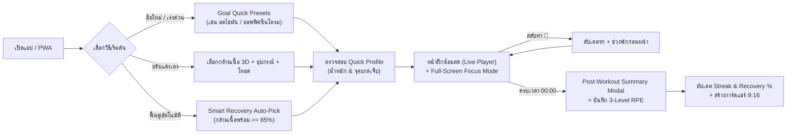

# Product Requirements Document (PRD)
# KINETIC MED-FIT 3D — v2.1 (Mobile-First UX, Reliability & Retention Upgrade)

| หัวข้อ | รายละเอียด |
| :--- | :--- |
| **ชื่อผลิตภัณฑ์** | **KINETIC MED-FIT 3D** |
| **เวอร์ชันเป้าหมาย** | `v2.1` (อัปเกรดจาก `v2.0`) |
| **แพลตฟอร์ม** | Responsive Web App, Offline-First PWA, Google Play Store (Capacitor / TWA Android) |
| **สถานะเอกสาร** | Ready for Engineering Implementation |

---

## 1. ภาพรวมผลิตภัณฑ์และวิสัยทัศน์ (Product Overview & Vision)

### 1.1 ปัญหาที่พบในปัจจุบัน (Problem Statement)
จากระบบ `v2.0` ที่มีจุดแข็งด้านโมเดลกายวิภาค 3 มิติทางการแพทย์ (16 มัดกล้ามเนื้อ), ระบบสร้างตารางตามกรอบเวลาแม่นยำ 100%, และเอนจินวิดีโอวนลูปเชิงกลศาสตร์ชีวภาพ ยังพบอุปสรรคหลัก 4 ประการที่ขัดขวางการใช้งานจริงและอัตราการกลับมาใช้งานซ้ำ:
1. **ความซับซ้อนทางสถาปัตยกรรมและ Offline Failure:** โค้ดถูกแยกเป็น Vanilla JS (`Index.html`) และ React (`src/`) ทำให้ฟีเจอร์ไม่ตรงกัน และการดึง CDN สดทำให้เปิดแบบออฟไลน์ไม่ได้จริง
2. **อุปสรรคสำหรับผู้ใช้ใหม่ (High Cognitive Load):** หน้าแรกเปิดมาด้วยศัพท์วิทยาศาสตร์การกีฬาและกายวิภาคศาสตร์จำนวนมาก ทำให้มือใหม่ไม่รู้ว่าควรเริ่มอย่างไรใน 3 วินาทีแรก
3. **Mobile-First Ergonomics ขณะฝึกจริง:** มีปัญหา Scroll Trap บนกรอบ 3D, ปุ่มควบคุมวิดีโอขนาดเล็ก (`~22px`), เสียงโค้ชช่วงพักที่ไม่อัปเดตเมื่อสลับท่า, และความเสี่ยงในการเผลอรีเซ็ตตารางกลางคัน
4. **ขาดกลไกกระตุ้นการกลับมาใช้ซ้ำ (Retention Gap):** ขาดระบบ Streak, Goal Presets, และหน้าต่างสรุปผลหลังจบเซสชันที่สร้างความภูมิใจ

### 1.2 เป้าหมายของเวอร์ชัน v2.1 (Release Goals)
- **Zero-Crash & Offline Ready:** รวม Codebase เป็น React + Vite เพียงหนึ่งเดียว พร้อม Offline PWA 100%
- **3-Second Start:** ผู้ใช้ใหม่กดเลือกเป้าหมายชีวิตจริงและเข้าสู่การฝึกได้ภายใน 3 วินาที
- **Sweat-Proof Mobile UX:** ใช้งานมือเดียวและมองเห็นตัวจับเวลาจากระยะ 1.5–2 เมตรได้อย่างชัดเจน
- **Habit-Forming Loop:** เพิ่ม Streak รายวัน, Body Profile ป้องกันการบาดเจ็บ, และ Post-Workout Summary

---

## 2. กลุ่มผู้ใช้งานเป้าหมาย (User Personas)

| Persona | ลักษณะและบริบท | ปัญหาหลัก (Pain Points) | สิ่งที่คาดหวังจาก v2.1 |
| :--- | :--- | :--- | :--- |
| **A. มือใหม่สายรักสุขภาพ (Home Beginner)** | ต้องการออกกำลังกายที่บ้าน ไม่มีอุปกรณ์หรือมีแค่เสื่อโยคะ | ไม่รู้จักชื่อกล้ามเนื้อภาษาอังกฤษ กลัวเลือกท่าผิดจนเจ็บเข่า/หลัง | มีปุ่มเป้าหมายเข้าใจง่าย (เช่น ลดพุง, ปั้นก้นไม่กระแทกเข่า) และช่วยกรองท่าอันตรายออก |
| **B. คนทำงานเวลาน้อย (Busy Office Worker)** | มีเวลาว่างช่วงพักหรือหลังเลิกงานแค่ 7–15 นาที ปวดคอ-บ่า-ไหล่ | ขี้เกียจตั้งค่าเยอะ ต้องการความเร็ว ทำตามท่าทางได้เลย | ปุ่มลัด "แก้ออฟฟิศซินโดรม 10 นาที", หน้าจอมือถือมองง่าย ไม่ต้องเพ่ง |
| **C. สายเวท/ฟิตเนสจริงจัง (Data-Driven Athlete)** | ออกกำลังกายสม่ำเสมอ มีดัมเบล/เคตเทิลเบล/บาร์โหน ติดตามความล้ากล้ามเนื้อ | ไม่อยากเล่นซ้ำมัดกล้ามเนื้อที่ยังล้า อยากได้แคลอรีและ BPM ที่แม่นยำ | โมเดล 3D EMG Heatmap ที่คำนวณจากเวลาที่ฝึกจริง, Smart Recovery Auto-Pick, BLE Heart Rate |

---

## 3. เส้นทางผู้ใช้งาน (User Journey & Flow)



---

## 4. ข้อกำหนดเชิงฟังก์ชัน (Functional Requirements)

### FR-01: Unified Application Shell & Offline PWA Architecture
- ระบบต้องทำงานผ่าน Single Entry Point (`src/main.jsx` → `src/App.jsx`) ด้วย Vite Build Pipeline
- ไฟล์ Asset หลัก (Tailwind CSS, Three.js, React, Video Engine, Workout Database) ต้องถูก Bundle ภายในแอปและแคชผ่าน Service Worker (`sw.js`) เพื่อให้ทำงาน Offline ได้สมบูรณ์

### FR-02: Goal-Based Quick Onboarding Presets
- แสดง Goal Cards บนสุดของหน้า Setup (สามารถพับเก็บได้สำหรับผู้ใช้ขั้นสูง) อย่างน้อย 4 รูปแบบ:
  1. `🔥 รีดไขมันเร่งด่วน (15 นาที)` → Full Body, `HIIT`, อุปกรณ์ที่มี, `Low-Impact: Off`
  2. `💻 แก้ปวดคอ-บ่า-ไหล่ ออฟฟิศซินโดรม (10 นาที)` → `neck_scm`, `shoulders_posterior_traps`, `rhomboids_erector`, `YOGA/CARDIO`, `Low-Impact: On`
  3. `🍑 ปั้นก้น & ขาเรียว ถนอมข้อเข่า (20 นาที)` → `glutes`, `hamstrings`, `quads`, `hip_adductors`, `CARDIO`, `Low-Impact: On`
  4. `💪 เวทสร้างกล้ามท่อนบนที่บ้าน (20 นาที)` → `chest_upper_Mid`, `lats_teres`, `shoulders_anterior_lateral`, `biceps_brachialis`, `triceps`, `HIIT`

### FR-03: Quick Body Profile & Joint Safety Filter
- ผู้ใช้สามารถตั้งค่าน้ำหนักตัว (`35–200 kg`, ค่าเริ่มต้น `70 kg`), อายุ, และเลือก **ข้อต่อที่บาดเจ็บ/ต้องระวัง** (`เข่า`, `ข้อมือ`, `หลังล่าง`, `หัวไหล่`) โดยไม่ต้องล็อกอิน
- ระบบคำนวณแคลอรีด้วยสูตร MET รายช่วง (`Work/Sprint`, `Rest`, `Warmup/Cooldown`) คูณด้วยน้ำหนักตัวจริงของผู้ใช้
- ท่าออกกำลังกายใน `EXERCISE_DATABASE` ที่ติดแท็ก `jointStress` ตรงกับข้อต่อที่ผู้ใช้ระบุว่าบาดเจ็บ จะถูกกรองออกโดยอัตโนมัติ (พร้อมข้อความแจ้งเตือนหากจำนวนท่าเหลือน้อยและจำเป็นต้องใช้ท่าทางเลือก)

### FR-04: Interactive 3D Medical Anatomy Selector (Mobile-Safe)
- รองรับ 3 โหมดการแสดงผล (`Ecorché Fiber`, `X-Ray Skeletal`, `EMG & ฟื้นตัว`)
- เพิ่มปุ่ม `🔒 ล็อกการหมุน 3D` บนมือถือเพื่อป้องกัน Scroll Trap
- การแตะ (Tap) บนโมเดล 3D ต้องอัปเดต Tooltip ชื่อไทย-อังกฤษและจุดยึดเกาะ (`originInsertion`) บนมือถือได้เช่นเดียวกับการ Hover บน Desktop
- เมื่ออยู่ในโหมด `ทั่วร่างกาย (Full Body)` แล้วผู้ใช้คลิกมัดกล้ามเนื้อใดมัดหนึ่ง ระบบต้องสลับมาโฟกัส **เฉพาะมัดกล้ามเนื้อนั้น** ทันที

### FR-05: Active Workout Protection & Schedule Integrity
- หาก `isRunning === true` หรือ `currentIndex > 0` การพยายามแก้ไขการตั้งค่าตารางต้องแสดง Confirm Dialog ก่อนล้างเวลาปัจจุบัน
- เมื่อกดปุ่ม `🔀 สลับท่า` ที่สเต็ป `WORK/SPRINT` ลำดับที่ $N$ ระบบต้องอัปเดตข้อมูลพรีวิวในสเต็ป `REST` ลำดับที่ $N-1$ (ชื่อท่า, Form Cue, วิดีโอ) ให้ตรงกับท่าใหม่ทันที

### FR-06: Video Loop Engine & Safe Fallback
- กรณีเบราว์เซอร์ไม่รองรับ `canvas.captureStream()` หรือ `video.play()` ถูกปฏิเสธ ระบบต้องแสดง `fallbackCanvasEl` อัตโนมัติ (ห้ามแสดงจอดำ)
- ใช้ Safe Rounded Rectangle Helper แทน `ctx.roundRect()` และแสดงภาพแบบ `object-contain` โดยไม่ให้ข้อความ HUD บน Canvas ทับปุ่มควบคุม HTML

### FR-07: Live Workout Player & Full-Screen Focus Mode
- ป้ายสถานะในวงแหวนเวลาต้องแสดงถูกต้องตามประเภทช่วง (`WARM-UP`, `WORK`, `SPRINT`, `ASANA`, `REST`, `COOL-DOWN`)
- แจ้งเตือนล่วงหน้า 5 วินาทีใช้ช่วง `remainingSec <= 5 && remainingSec > 3` ร่วมกับ Flag กันซ้ำต่อสเต็ป
- มีปุ่ม **Focus Mode (เต็มจอ)** ที่ขยายวิดีโอ, ตัวเลขนับถอยหลัง (`>= 48px`), และปุ่ม `Play/Pause`, `Skip`, `Swap` ให้มองเห็นชัดเจนจากระยะ 1.5–2 เมตร
- ปุ่มควบคุมบนมือถือต้องมีพื้นที่สัมผัสไม่น้อยกว่า `36–44px`
- Pranayama Breath Pacer ต้องรีเซ็ตเป็นจังหวะ `สูดหายใจเข้า (Inhale)` ทุกครั้งเมื่อขึ้นสเต็ปใหม่ และใช้อัตราส่วนลมหายใจตาม `fitnessLevel`

### FR-08: Telemetry & Physiology Accuracy
- แถบ BPM เมื่อยังไม่กดเริ่มฝึกต้องแสดงเป็นช่วงเป้าหมาย (`🎯 Target: XXX–XXX BPM`) และระบุว่าเป็นค่าประมาณ (`Est.`) เมื่อไม่ได้เชื่อมต่ออุปกรณ์จริง
- รองรับการเชื่อมต่อ **Web Bluetooth Heart Rate (`0x180D`)** เป็น Option เสริมบนเบราว์เซอร์ที่รองรับ
- ระบบ `logCompletedWorkoutSession` ต้องคำนวณการลดลงของ % Recovery ตามระยะเวลาฝึกจริงและค่า `% EMG Activation` ของแต่ละท่าที่ทำสำเร็จ

### FR-09: Post-Workout Summary, RPE & Retention Loop
- เมื่อฝึกจบ `00:00` เปิดหน้าต่างสรุปผลเต็มหน้าจอพร้อมปุ่มประเมินความเหนื่อย 3 ระดับ (`😊 สบายมาก`, `💦 กำลังดี`, `🥵 เหนื่อยสุด ๆ`)
- บันทึกวันที่ฝึกสำเร็จเพื่อแสดง **Daily Workout Streak (`🔥 X วัน`)** และ **Weekly Consistency Goal**
- มีปุ่มบันทึกภาพสรุปผลขนาด `9:16` ที่มีภาพโมเดล 3D ไฮไลต์กล้ามเนื้อที่เพิ่งฝึกเสร็จเพื่อแชร์ลงโซเชียล

---

## 5. โครงสร้างข้อมูลและ LocalStorage Schema (Data Model)

### 5.1 User Profile (`kinetic_3d_user_profile_v1`)
```json
{
  "weightKg": 65,
  "heightCm": 170,
  "age": 30,
  "weeklyGoalDays": 4,
  "injuredJoints": ["knee"],
  "preferredGoal": "office_syndrome",
  "developerMode": false
}
```

### 5.2 Workout History & Recovery (`kinetic_3d_workout_history_v2_1`)
```json
{
  "totalSessions": 12,
  "totalMinutes": 215,
  "totalKcal": 1840,
  "currentStreakDays": 4,
  "bestStreakDays": 7,
  "workoutDates": ["2026-11-12", "2026-11-13", "2026-11-14", "2026-11-15"],
  "lastModality": "HIIT",
  "recentRpe": [
    { "date": "2026-11-15", "modality": "HIIT", "durationMin": 20, "rpe": "just_right" }
  ],
  "muscleFatigue": {
    "chest_upper_Mid": { "score": 68, "lastTrainedAt": 1794756000000 },
    "quads": { "score": 74, "lastTrainedAt": 1794756000000 }
  }
}
```

---

## 6. ข้อกำหนดที่ไม่ใช่เชิงฟังก์ชัน (Non-Functional Requirements)

| หมวดหมู่ | ข้อกำหนด (Requirement) |
| :--- | :--- |
| **ประสิทธิภาพ (Performance)** | - 3D Viewport ทำงานได้ลื่นไหล `>= 30–60 FPS` บนสมาร์ทโฟนระดับกลาง<br>- Video Canvas Stream ทำงานที่ `30 FPS` โดยไม่เกิด Memory Leak เมื่อสลับท่าหรือเปลี่ยนหน้าแท็บ (`engine.stop()` เมื่อ Unmount) |
| **ความเข้ากันได้ (Compatibility)** | - รองรับ Chrome Android, Safari iOS 15+, Desktop Edge/Chrome/Firefox, และ Capacitor Android WebView<br>- ป้องกันการพังหาก API เสริมไม่พร้อมใช้งาน (`WakeLock`, `Web Speech`, `Vibration`, `Web Bluetooth`, `captureStream`) |
| **การออกแบบมือถือ (Mobile-First)** | - รองรับความกว้างหน้าจอตั้งแต่ `360px` ขึ้นไปโดยไม่มี Horizontal Overflow<br>- ปุ่มควบคุมหลักขณะออกกำลังกายต้องมี Touch Target อย่างน้อย `44x44px` |
| **ความเป็นส่วนตัวและความปลอดภัย** | - ข้อมูลโปรไฟล์และประวัติการฝึกเก็บใน `localStorage` ของเครื่องผู้ใช้ 100% (No server tracking)<br>- แสดงข้อความแนะนำความปลอดภัยเบื้องต้นสำหรับผู้มีโรคประจำตัวหรือบาดเจ็บก่อนเริ่มโหมดความเข้มข้นสูง (`HIIT / REHIT`) |

---

## 7. ตัวชี้วัดความสำเร็จและแผนการปล่อยเวอร์ชัน (KPIs & Rollout Plan)

### ตัวชี้วัดความสำเร็จ (Success Metrics)
- **Time-to-First-Workout:** ผู้ใช้ใหม่กดเข้าสู่หน้าฝึกซ้อมได้ภายใน **< 15 วินาที** หลังจากเปิดเว็บ
- **Workout Completion Rate:** อัตราผู้ที่กด `▶ เริ่มฝึก` แล้วฝึกจนจบครบ `00:00` เพิ่มขึ้นอย่างน้อย **+35%**
- **D7 Retention / Streak Engagement:** ผู้ใช้กลับมาฝึกซ้ำมากกว่า 2 วันในสัปดาห์แรกเพิ่มขึ้นจากฟีเจอร์ Goal Presets และ Streak
- **Zero Offline / Swap Bug:** ไม่พบข้อผิดพลาดจากโหมด Offline, การสลับท่า (`🔀`), และ Video Fallback บน iOS/Android

### แผนการพัฒนา (Phased Rollout)
1. **Phase 1 (Sprint 1 — Stabilization Hotfix):** รวม React/Vite Codebase (`CR-001`), แก้ Offline PWA (`CR-002`), แก้บั๊ก Swap/Fallback/Scroll/Telemetry (`CR-003` ถึง `CR-010`)
2. **Phase 2 (Sprint 2 — Core UX & Must-Haves):** เปิดใช้งาน Goal Presets, Body Profile & Injury Filter, Full-Screen Focus Mode, Post-Workout Summary + RPE
3. **Phase 3 (Sprint 3–4 — Retention & Smart Growth):** เปิดใช้งาน Streak & Weekly Goal, Smart Recovery Auto-Pick, Tempo Metronome, BLE Heart Rate, 7-Day Challenges และ Shareable 3D Cards
